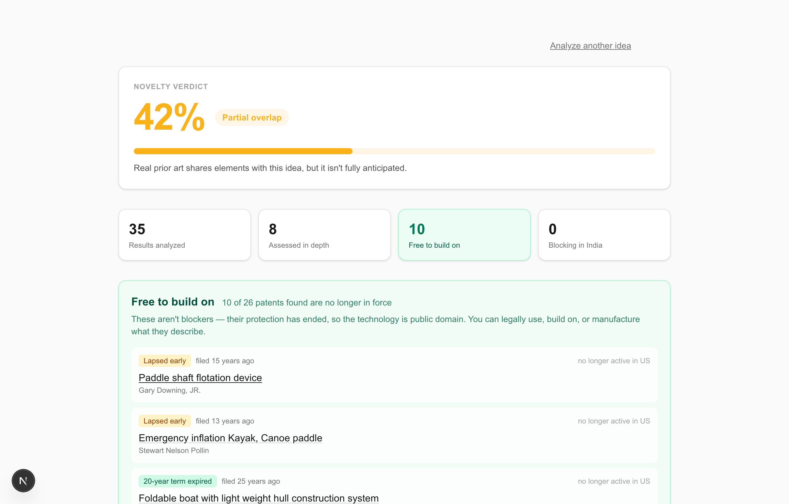
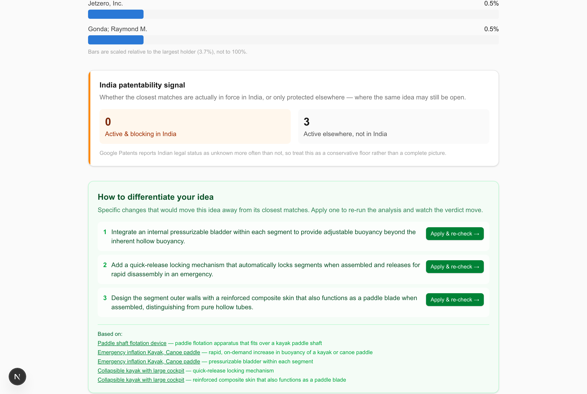

# PriorArt AI

**AI-powered patent prior-art & novelty checker.** Paste an invention idea in plain
English and get back ranked prior art (patents, academic papers, and existing
products), a novelty verdict with reasoning and citations, an interactive
patent-landscape graph, and concrete suggestions for how to differentiate your idea
from what already exists.

It also does the inverse, which most prior-art tools don't: it identifies the patents
in your space whose **protection has already expired**. Those aren't obstacles — they're
published technology that has passed into the public domain, free for anyone to build
on. In testing, a typical search surfaced 10 such patents out of 26.

It's built for independent inventors, students, and early-stage founders who want a
first read on "has this already been done?" before spending money on a formal patent
search — patent search tools built for law firms are expensive and not designed for
someone doing a first-pass sanity check on a raw idea.

**Hackathon:** SerpApi India Hackathon 2026 — **Track 05: Knowledge & Public Interest**.
Patent information is public data that is locked behind expensive, jargon-heavy tools;
this project makes that knowledge accessible to anyone who can describe an idea in
plain English, which is squarely a "public interest" use of freely searchable
government/patent-office data. The public-domain finder pushes that further: the
patent bargain is that inventions become public once protection lapses, but in
practice almost nobody can find out *which* ones have. This surfaces them.

---

## How it works

```mermaid
flowchart TD
    idea(["💡 Idea text<br/><i>plain English</i>"])

    subgraph pipeline [" "]
        direction TB
        q["<b>1 · Query Generator</b> — LLM<br/>2-4 Google Patents boolean queries<br/><span style='font-size:11px'>major markets · India-specific · broad recall</span>"]
        s["<b>2 · Search Layer</b> — SerpApi<br/>google_patents (patents + scholar) per query<br/><span style='font-size:11px'>+ one plain google query for market availability</span>"]
        r["<b>3 · Rank & Dedupe</b><br/>merge, dedupe by id<br/><span style='font-size:11px'>score relevance via sentence-transformer embeddings</span>"]
        d["<b>4 · Deep-Dive</b> — SerpApi<br/>full claims/abstract for top 5-8 candidates<br/><span style='font-size:11px'>via google_patents_details, truncated/condensed</span>"]
        n["<b>5 · Novelty Verdict</b> — LLM<br/>overlap/differences/verdict per candidate<br/><span style='font-size:11px'>+ confidence + differentiation + citations + claim spans</span>"]
        i["<b>6 · India Signal + Public Domain</b><br/><span style='font-size:11px'>computed from data already pulled in step 2 — no extra API calls</span>"]
        o["<b>7 · Orchestrator</b><br/><span style='font-size:11px'>async generator → staged progress events → one structured result</span>"]

        q --> s --> r --> d --> n --> i --> o
    end

    api{{"⚡ FastAPI · POST /analyze<br/><i>Server-Sent Events</i>"}}

    fe["🖥️ <b>Next.js frontend</b><br/>staged progress checklist<br/>ranked result cards<br/>India signal + differentiation<br/>force-directed landscape graph<br/>claim-chart highlighting"]

    idea --> q
    o --> api --> fe

    classDef stage fill:#eef2ff,stroke:#6366f1,stroke-width:1.5px,color:#1e1b4b,text-align:left
    classDef endpoint fill:#fef3c7,stroke:#d97706,stroke-width:1.5px,color:#451a03
    classDef terminus fill:#ecfdf5,stroke:#059669,stroke-width:1.5px,color:#064e3b
    classDef ideaNode fill:#fce7f3,stroke:#db2777,stroke-width:1.5px,color:#500724

    class q,s,r,d,n,i,o stage
    class api endpoint
    class fe terminus
    class idea ideaNode
    style pipeline fill:none,stroke:none
```



**Backend:** Python, FastAPI, Server-Sent Events for streaming progress.
**Frontend:** Next.js (App Router) + TypeScript + Tailwind, `react-force-graph-2d`
for the landscape graph.
**LLM:** Groq (`openai/gpt-oss-120b`, OpenAI-compatible API) — swapped in for Claude
to keep the project free to run; all LLM calls go through one wrapper
(`backend/app/llm.py`) so the provider can be swapped again in one file.
**Search:** SerpApi (`google_patents`, `google_patents_details`, `google`).

---

## Project structure

```
priorart-ai/
├── backend/
│   ├── app/
│   │   ├── main.py              # FastAPI app, POST /analyze SSE endpoint
│   │   ├── llm.py                # Groq LLM wrapper (all model calls go through here)
│   │   ├── cache.py              # memory + on-disk cache keyed on idea text
│   │   ├── models.py             # SSE event / result Pydantic models
│   │   ├── serpapi_client.py     # shared SerpApi client (+ API-key redaction)
│   │   └── pipeline/
│   │       ├── query_generator.py    # 1.1
│   │       ├── search.py             # 1.2
│   │       ├── rank.py               # 1.3
│   │       ├── deepdive.py           # 1.4
│   │       ├── novelty.py            # 1.5 (+ claim chart)
│   │       ├── india_status.py       # 1.6
│   │       ├── public_domain.py      # expired-patent finder
│   │       └── orchestrator.py       # 1.7 — wires it all together
│   ├── tests/test_pipeline.py    # pure-logic tests (no keys/network needed)
│   ├── .cache/                   # persisted analyses — survives restarts
│   └── requirements.txt
└── frontend/
    ├── app/page.tsx               # top-level view state machine
    ├── components/                # IdeaForm, ProgressChecklist, ResultsView,
    │                               # LandscapeGraph, ClaimChart, CompetitorLandscape
    ├── lib/                       # analyzeStream.ts (SSE client), landscapeGraph.ts,
    │                               # highlightText.tsx
    └── types/analysis.ts          # shared contract with the backend
```

---

## Setup

### Prerequisites

- Python 3.11+
- Node.js 20+
- A [SerpApi](https://serpapi.com) API key (free tier works for local testing)
- A [Groq](https://console.groq.com) API key (free tier)

### Backend

```bash
cd backend
python3 -m venv venv
source venv/bin/activate        # Windows: venv\Scripts\activate
pip install -r requirements.txt
cp .env.example .env
```

Fill in `backend/.env`:

```
SERPAPI_API_KEY=your_serpapi_key
GROQ_API_KEY=your_groq_key
GROQ_MODEL=openai/gpt-oss-120b
```

Run it:

```bash
uvicorn app.main:app --port 8000
```

Confirm it's up: `curl http://localhost:8000/health` → `{"status":"ok"}`

### Frontend

```bash
cd frontend
npm install
```

Create `frontend/.env.local`:

```
NEXT_PUBLIC_API_URL=http://localhost:8000
```

Run it:

```bash
npm run dev
```

Open the printed local URL (defaults to `http://localhost:3000`, or the next free
port if that one's taken) and paste in an invention idea.

### API quota and caching

A single analysis costs **4-12 SerpApi searches** (3 patent queries + 1 market
query + up to 8 claim lookups). SerpApi's free tier allows 250/month, so roughly
20-60 analyses.

Because of that, every completed analysis is cached to `backend/.cache/`, keyed on
a hash of the idea text. The cache is **persistent across restarts** — re-running
the same idea replays the saved result instantly and costs nothing, which is what
makes a demo reproducible without live quota. Delete a file from `backend/.cache/`
to force a fresh run of that idea.

If the search quota runs out, the app says so explicitly rather than reporting
"no results found" — an empty result and a failed search are reported differently
on purpose.

### Running the tests

```bash
cd backend
source venv/bin/activate
python -m pytest tests/ -q
```

The suite covers the pipeline's pure logic — dedupe/merge rules, the India status
tally, LLM-output validation guards, claim truncation, and cache persistence. It
needs no API keys and no network, and runs in a few seconds.

---

## Screenshots

**Input screen**


**Staged progress** — each pipeline stage checks off live as it runs, so the
multi-step pipeline is visibly real, not a single spinner:


**Novelty verdict** — the headline answer, with a severity-coded meter and the
counts behind it:



**Free to build on** — prior art whose protection has lapsed, separated into patents
past the 20-year term and those abandoned early:


**Patent-landscape graph** — nodes are search results, sized and pulled closer to
the idea node by relevance, colored by CPC patent classification:


**Who owns this space** — assignee concentration from SerpApi's clustered search
summary, with an explicit note when the field is too fragmented for any holder to
dominate:


**Differentiation suggestions** — concrete, cited changes that would move the idea
away from its closest matches. "Apply & re-check" folds a suggestion into the idea
and re-runs the whole pipeline, showing the verdict shift:



**Claim chart** — a side-by-side comparison of the idea against its closest match,
with matching colors marking the same technical concept in both texts (the
technique patent professionals call "claim charting"):


---

## Known limitations

- **India legal-status data**: Google Patents' legal-status tracking for the Indian
  Patent Office is often `UNKNOWN` rather than `ACTIVE`/`NOT_ACTIVE` — a real gap in
  Google's own data coverage, not a bug in this tool. The India signal is accurate
  to what Google Patents reports, which is sometimes incomplete for `IN` filings.
- **Public-domain status is indicative, not legal advice.** It relies on the legal
  status Google Patents reports, which is incomplete for some jurisdictions, and a
  patent lapsed early for unpaid fees can occasionally be revived. The tool
  deliberately requires positive evidence of lapse (never treating "unknown" as
  free) and labels the two cases differently, but verify with an attorney before
  relying on it commercially.
- **Novelty confidence reflects textual/conceptual overlap**, not scientific or
  technical plausibility — it can't tell you an idea is implausible, only that it
  does or doesn't textually overlap with what search turned up.
- **Claim-chart highlighting** depends on the LLM copying spans verbatim from the
  source text; when it paraphrases instead (common with longer patent claim text),
  that pair is silently skipped rather than mis-highlighted. Expect it to show
  fewer highlighted pairs on some runs than others.
- **Embedding-based relevance ranking** uses a general-purpose English
  sentence-transformer model, not one specifically trained for multilingual or
  patent-domain text — ranking quality is best for English, technically-worded
  ideas.

---

## Disclosure

This is a new project, built from scratch for the SerpApi India Hackathon 2026.

**AI tools used in development:** [Claude Code](https://claude.com/claude-code)
(Anthropic) was used as an AI pair-programmer throughout development — writing and
testing the backend pipeline, the frontend, and this documentation.

**AI/APIs used at runtime by the app itself:** Groq (hosting `openai/gpt-oss-120b`)
powers the LLM reasoning steps (query generation, novelty assessment, claim
charting); SerpApi powers all patent/scholar/product search.
