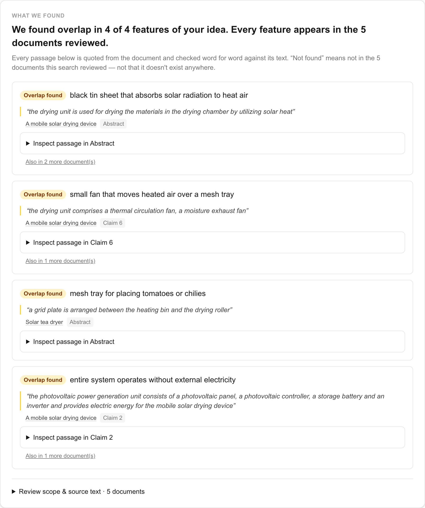
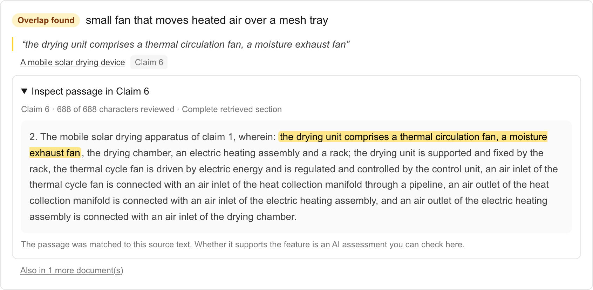
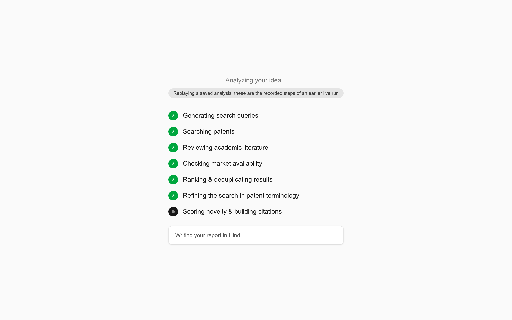
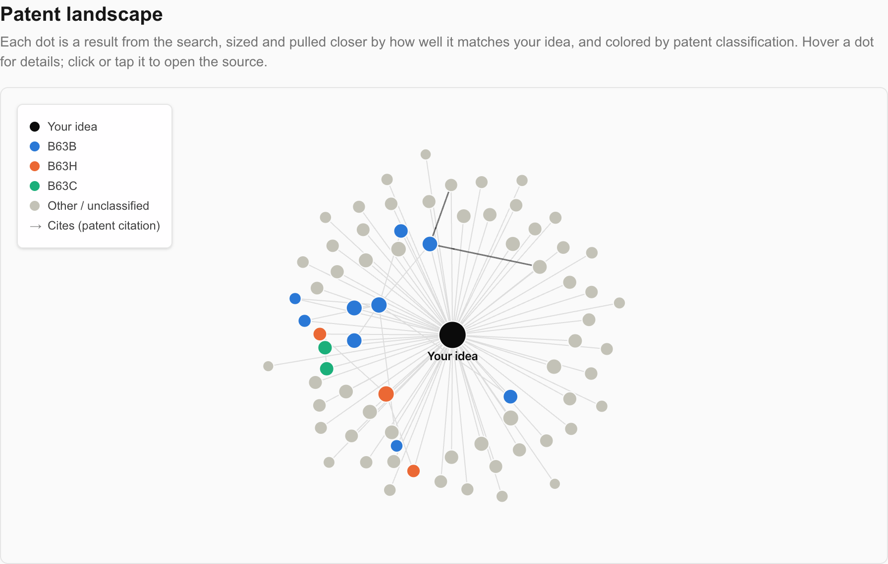
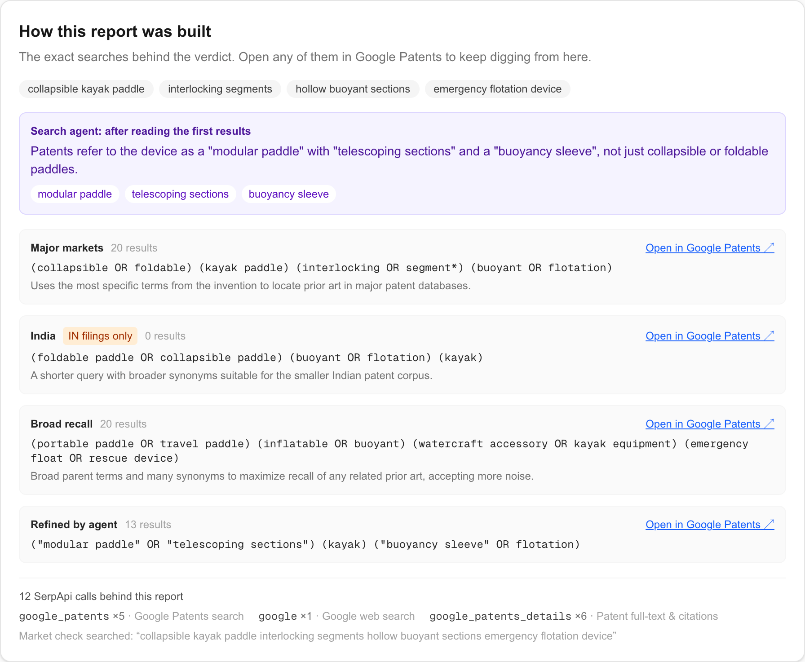

# PriorArt AI

[](https://github.com/rmnvg/priorart-ai/actions/workflows/ci.yml)

**Has my invention already been done? Ask in your own language and get the answer
with the evidence: the exact patent passages, checked word for word.**

**▶ [Demo video (3 min)](TODO-VIDEO-LINK)** · **[Try it live, no sign-up](TODO-LIVE-LINK)** ·
SerpApi India Hackathon 2026, Track 05: Knowledge & Public Interest

<!-- TODO: one real user's quote goes here, e.g. > "..." — name, role. Never invent one. -->



A farmer describes a solar crop dryer **in Hindi**. PriorArt AI searches patents,
papers and products through SerpApi and answers with evidence, not a score: each
feature of the idea is matched to the passage of a real patent that shows it,
checked word for word against that patent's claims or abstract in code. Then it
helps her **redesign around what exists**, under her own constraints ("no
electricity", "under ₹2,000"), and re-checks the new design against the same patents.

## Why it's different

1. **Evidence, not a score.** The LLM never gets the last word: a quote that isn't in
   the patent's text is rejected in code. The novelty estimate is shown, small and
   labelled as an estimate, below the evidence.
2. **It searches like a professional.** An agent reads the first results, learns the
   patents' own vocabulary ("patents call this a *solar air heater*, not a black tin
   sheet") and searches again. Then it chases citations.
3. **Built for India.** It works in Indian languages end to end, searches Indian Patent
   Office filings, and previews how an Indian examiner would read the idea
   (Patents Act s. 3, 2(1)(j), 2(1)(ja)), labelled as a simulation.
4. **It finds what's free to use.** Patents in your space whose protection is reported
   as ended, and where. The patent bargain says these are public; this tool makes them
   findable. The Hindi crop-dryer report lists 12 of them.

**How well does it find prior art?** Honestly measured: on 5 held-out, famous
inventions from 1917–1983 (zipper, Velcro, Frisbee, LEGO brick, Rubik's cube) it found
the original patent in **0 of 5**. Keyword search surfaces the hundreds of later
patents in the same field first. It is built to find **recent, active** prior art,
the kind that blocks a filing today, and it does not replace a professional search.
[Full benchmark](docs/benchmark.md).

## See it

| | |
|---|---|
|  |  |
| **Inspect the source.** Click any finding to see the highlighted passage in the patent's claim or abstract, and how much of it was reviewed. | **Redesign studio.** Lock what must stay, set constraints, get three designs, each tied to the quoted passage it moves away from. |
|  |  |
| **A visible pipeline.** Each stage checks off live, including the agent's own note on the patents' vocabulary. Saved runs say they are replays. | **Free to build on.** Patents in the space reported as lapsed or expired, and where. |
|  |  |
| **Patent landscape.** Results sized and placed by relevance, colored by classification, with real citation edges. | **How this report was built.** Every query, its result count and every SerpApi call, each query reopenable in Google Patents. |

## Try it without API keys

```bash
cd backend && python3 -m venv venv && source venv/bin/activate
pip install -r requirements.txt && uvicorn app.main:app --port 8000
# second terminal
cd frontend && npm install && npm run dev
```

With no keys the backend runs in **demo mode**: the six example reports (Hindi crop
dryer, clay fridge, cattle collar, herbal wound paste, e-rickshaw battery swap, kayak
paddle) open fully interactive. [Full setup with live search](docs/setup.md).

## How SerpApi powers it

Nothing in a report is made up by the LLM. Every document, status, date and
citation comes from SerpApi; the LLM only writes the queries and compares texts.

| SerpApi engine | Calls per analysis | What it provides |
|---|---|---|
| `google_patents` (`clustered=true`, `num=20`) | 3 + 1 refinement | Prior-art patents, 20 per query angle. The India angle adds `country=IN`, so it searches Indian Patent Office filings for real. Each result's `country_status` feeds the India signal and the public-domain finder, and the clustered `summary` feeds the assignee breakdown. |
| `google_patents` (`scholar=true`, `patents=false`) | 1 | Academic papers for the broad-recall query, in a call of their own. Mixed into the patent queries, papers filled the whole first page on research-heavy topics (a solar crop dryer: 19 papers, 1 patent), leaving no claims to quote. |
| `google_patents_details` | up to 8 + 2 | Full abstract + claims for the feature evidence and claim chart, plus `patent_citations` / `cited_by` for **citation chasing** and the citation edges in the landscape graph. Up to 2 more calls **follow up** the strongest citation discoveries, so a document keyword search missed can change the conclusion. |
| `google` | 1 | Market-availability check: is a product like this already sold? |
| `google_trends` | 1 | Five years of search interest in the product category: does anyone want this? |

The refinement agent's follow-up query goes through the same `google_patents`
engine, so its extra search is counted in that row.

Every report ends with a **"How this report was built"** panel. It lists the exact
queries, the result count for each, and the SerpApi calls behind that report, and
each query opens in Google Patents so the user can keep searching from there.

## Why Track 05

Patent information is public data locked behind expensive, jargon-heavy tools. This
project makes it usable by anyone who can describe an idea, in their own language. The
public-domain finder pushes that further: inventions become public once protection
lapses, but almost nobody can find out *which* ones have. This surfaces them.

## More

- [Everything it does](docs/features.md): inventor interview, challenge a finding,
  apply & re-check, sketch input, examination preview, ask the report, MCP server
- [How it works](docs/how-it-works.md): the pipeline and the project structure
- [Setup, quota and tests](docs/setup.md), including the
  [MCP server](docs/setup.md#use-it-from-claude-desktop-cursor-or-any-mcp-client)
  for Claude Desktop and Cursor
- [Benchmark](docs/benchmark.md) · [Known limitations](docs/limitations.md) ·
  [Validation status](docs/validation-status.md)

## Disclosure

This is a new project, built from scratch for the SerpApi India Hackathon 2026.

**AI tools used in development:** [Claude Code](https://claude.com/claude-code)
(Anthropic) was used as an AI pair-programmer throughout development — writing and
testing the backend pipeline, the frontend, and this documentation.
Codex (OpenAI) helped implement and test the inventor interview, source-section
evidence review, and validation documentation.

**AI/APIs used at runtime by the app itself:** Groq (hosting `openai/gpt-oss-120b`)
powers the LLM reasoning steps (translation, query generation, search refinement,
novelty assessment, claim charting, report localization, redesign proposals), and
Groq-hosted `qwen/qwen3.8-27b` reads uploaded sketches; SerpApi powers all
patent, scholar, product and Trends search. Voice input uses the browser's built-in
Web Speech API.
