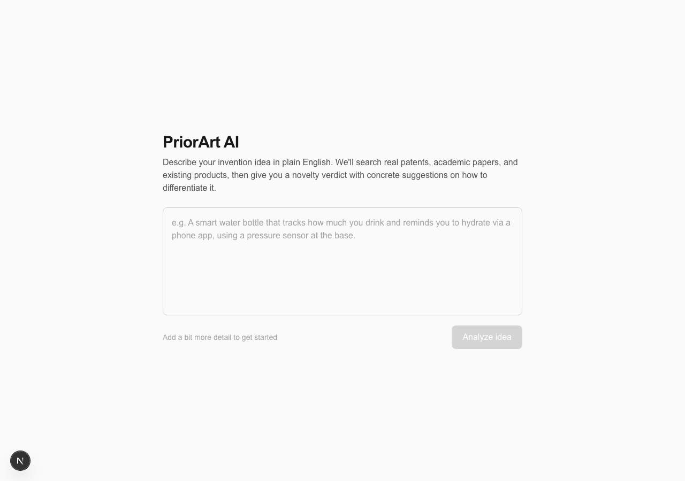
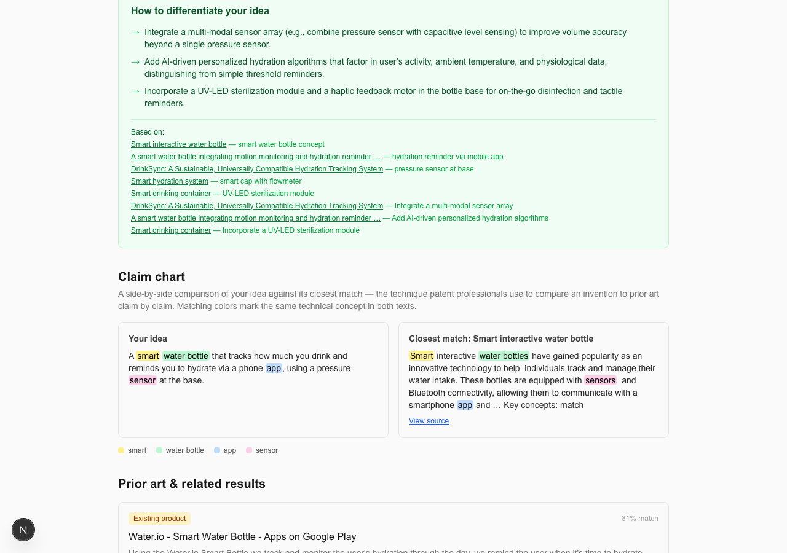

# PriorArt AI

**AI-powered patent prior-art & novelty checker.** Paste an invention idea in plain
English and get back ranked prior art (patents, academic papers, and existing
products), a novelty verdict with reasoning and citations, an interactive
patent-landscape graph, and concrete suggestions for how to differentiate your idea
from what already exists.

It's built for independent inventors, students, and early-stage founders who want a
first read on "has this already been done?" before spending money on a formal patent
search — patent search tools built for law firms are expensive and not designed for
someone doing a first-pass sanity check on a raw idea.

**Hackathon:** SerpApi India Hackathon 2026 — **Track 05: Knowledge & Public Interest**.
Patent information is public data that is locked behind expensive, jargon-heavy tools;
this project makes that knowledge accessible to anyone who can describe an idea in
plain English, which is squarely a "public interest" use of freely searchable
government/patent-office data.

---

## How it works

```
 idea text (plain English)
        │
        ▼
 1. Query Generator (LLM)        → 2-4 Google Patents boolean queries
        │                          (major markets / India-specific / broad recall)
        ▼
 2. Search Layer (SerpApi)       → google_patents (patents + scholar) per query
        │                          + one plain google query (market availability)
        ▼
 3. Rank & Dedupe                → merge, dedupe by id, score relevance to the
        │                          idea via sentence-transformer embeddings
        ▼
 4. Deep-Dive (SerpApi)          → full claims/abstract for the top 5-8 candidates
        │                          via google_patents_details, truncated/condensed
        ▼
 5. Novelty Verdict (LLM)        → one richer LLM call: per-candidate overlap/
        │                          differences/verdict + overall novelty confidence
        │                          + differentiation suggestions + citations +
        │                          claim-chart spans, all in a single response
        ▼
 6. India Patentability Signal   → computed directly from country_status data
        │                          already pulled in step 2 (no extra API call)
        ▼
 7. Orchestrator                 → async generator yielding staged progress events,
                                    ending in one structured result
        │
        ▼
 FastAPI POST /analyze (SSE)  ──────────────►  Next.js frontend
                                                 - staged progress checklist
                                                 - ranked result cards
                                                 - India signal + differentiation
                                                 - force-directed landscape graph
                                                 - claim-chart highlighting
```

**Backend:** Python, FastAPI, Server-Sent Events for streaming progress.
**Frontend:** Next.js (App Router) + TypeScript + Tailwind, `react-force-graph-2d`
for the landscape graph.
**LLM:** Groq (`openai/gpt-oss-120b`, OpenAI-compatible API) — swapped in for Claude
to keep the project free to run; all LLM calls go through one wrapper
(`backend/app/llm.py`) so the provider can be swapped again in one file.
**Search:** SerpApi (`google_patents`, `google_patents_details`, `google`).

---

## Project structure

```
priorart-ai/
├── backend/
│   ├── app/
│   │   ├── main.py              # FastAPI app, POST /analyze SSE endpoint
│   │   ├── llm.py                # Groq LLM wrapper (all model calls go through here)
│   │   ├── cache.py              # in-memory cache keyed on idea text
│   │   ├── models.py             # SSE event / result Pydantic models
│   │   ├── serpapi_client.py     # shared SerpApi client
│   │   └── pipeline/
│   │       ├── query_generator.py    # 1.1
│   │       ├── search.py             # 1.2
│   │       ├── rank.py               # 1.3
│   │       ├── deepdive.py           # 1.4
│   │       ├── novelty.py            # 1.5 (+ claim chart)
│   │       ├── india_status.py       # 1.6
│   │       └── orchestrator.py       # 1.7 — wires it all together
│   └── requirements.txt
└── frontend/
    ├── app/page.tsx               # top-level view state machine
    ├── components/                # IdeaForm, ProgressChecklist, ResultsView,
    │                               # LandscapeGraph, ClaimChart
    ├── lib/                       # analyzeStream.ts (SSE client), landscapeGraph.ts,
    │                               # highlightText.tsx
    └── types/analysis.ts          # shared contract with the backend
```

---

## Setup

### Prerequisites

- Python 3.11+
- Node.js 20+
- A [SerpApi](https://serpapi.com) API key (free tier works for local testing)
- A [Groq](https://console.groq.com) API key (free tier)

### Backend

```bash
cd backend
python3 -m venv venv
source venv/bin/activate        # Windows: venv\Scripts\activate
pip install -r requirements.txt
cp .env.example .env
```

Fill in `backend/.env`:

```
SERPAPI_API_KEY=your_serpapi_key
GROQ_API_KEY=your_groq_key
GROQ_MODEL=openai/gpt-oss-120b
```

Run it:

```bash
uvicorn app.main:app --port 8000
```

Confirm it's up: `curl http://localhost:8000/health` → `{"status":"ok"}`

### Frontend

```bash
cd frontend
npm install
```

Create `frontend/.env.local`:

```
NEXT_PUBLIC_API_URL=http://localhost:8000
```

Run it:

```bash
npm run dev
```

Open the printed local URL (defaults to `http://localhost:3000`, or the next free
port if that one's taken) and paste in an invention idea.

---

## Screenshots

**Input screen**



**Staged progress** — each pipeline stage checks off live as it runs, so the
multi-step pipeline is visibly real, not a single spinner:


**Patent-landscape graph** — nodes are search results, sized and pulled closer to
the idea node by relevance, colored by CPC patent classification:


**Claim chart** — a side-by-side comparison of the idea against its closest match,
with matching colors marking the same technical concept in both texts (the
technique patent professionals call "claim charting"):



---

## Known limitations

- **India legal-status data**: Google Patents' legal-status tracking for the Indian
  Patent Office is often `UNKNOWN` rather than `ACTIVE`/`NOT_ACTIVE` — a real gap in
  Google's own data coverage, not a bug in this tool. The India signal is accurate
  to what Google Patents reports, which is sometimes incomplete for `IN` filings.
- **Novelty confidence reflects textual/conceptual overlap**, not scientific or
  technical plausibility — it can't tell you an idea is implausible, only that it
  does or doesn't textually overlap with what search turned up.
- **Claim-chart highlighting** depends on the LLM copying spans verbatim from the
  source text; when it paraphrases instead (common with longer patent claim text),
  that pair is silently skipped rather than mis-highlighted. Expect it to show
  fewer highlighted pairs on some runs than others.
- **Embedding-based relevance ranking** uses a general-purpose English
  sentence-transformer model, not one specifically trained for multilingual or
  patent-domain text — ranking quality is best for English, technically-worded
  ideas.

---

## Disclosure

This is a new project, built from scratch for the SerpApi India Hackathon 2026.

**AI tools used in development:** [Claude Code](https://claude.com/claude-code)
(Anthropic) was used as an AI pair-programmer throughout development — writing and
testing the backend pipeline, the frontend, and this documentation.

**AI/APIs used at runtime by the app itself:** Groq (hosting `openai/gpt-oss-120b`)
powers the LLM reasoning steps (query generation, novelty assessment, claim
charting); SerpApi powers all patent/scholar/product search.
