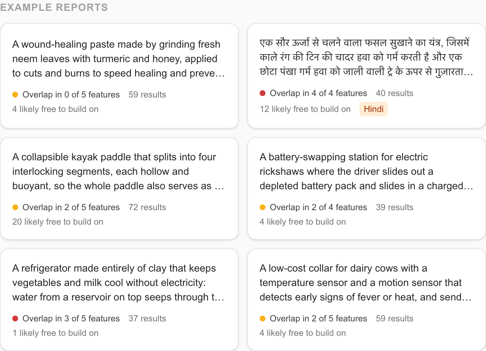
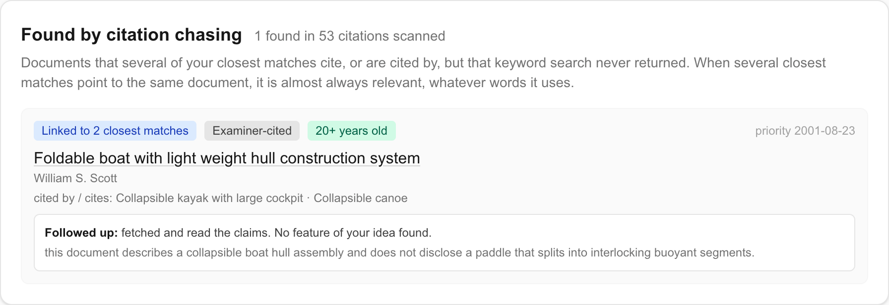
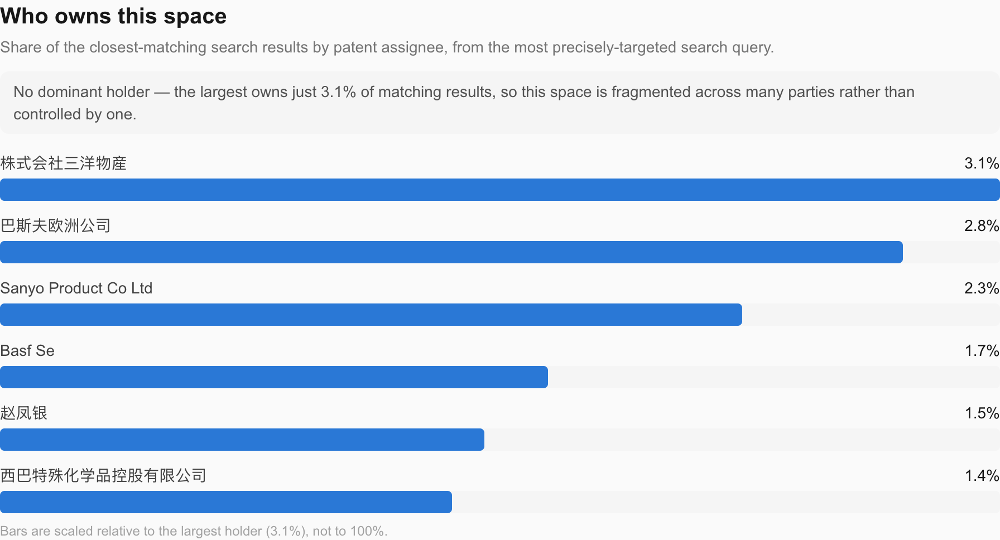

# Everything it does

[← Back to the README](../README.md)

**AI-powered patent prior-art & novelty checker.** Describe an invention idea in
plain words (typed or spoken, in English, Hindi or another Indian language) and get
back ranked prior art (patents, academic papers, and existing
products), a feature-by-feature evidence check, an interactive patent-landscape graph,
and concrete suggestions for how to differentiate your idea from what already exists.

**Clarify before searching.** The optional inventor interview asks up to three
questions in the inventor's language about missing mechanisms, relationships, or
distinguishing features. Already specific descriptions can proceed without questions.
The inventor can skip unknown details, edit the exact combined description, and
confirm it before any search runs. Original wording and inventor-written answers
are preserved; the interview does not generate a replacement invention.

The report leads with **evidence, not a score**: *"We found overlap in these three
features. This fourth feature wasn't found in the evidence reviewed."* Under each
feature is the exact passage from the document that shows it, checked word for word
against that document's text in code, and whether it came from the patent's claims, its
abstract, or only a search snippet. "Not found" is always bounded by what was reviewed.
The model's overall novelty estimate is still shown, as a small, labelled estimate.

**Inspect the source.** New reports keep the abstract and numbered claims separate.
Click a finding to see its highlighted passage in the actual reviewed section;
expand review scope to see the retrieved claim count and any truncation. The initial
review uses up to 2,400 characters of the abstract and 1,600 characters from each of
the first six claims per patent. Matching a quote verifies its presence, not the
correctness of the model's interpretation. Older saved reports remain readable and
explicitly indicate when section-level coverage was not recorded.

**Challenge this finding:** every feature marked “not found” in a saved report
can trigger a targeted second investigation. Two searches try the feature's
mechanism and alternative patent terminology; up to three patents are checked
against that specific feature. The follow-up shows the original finding alongside
the new result, exact verified passages, their abstract/claim sections, the queries,
and whether each document was previously reviewed. A failed or incomplete check
is distinguished from a completed search with no supporting passage.

Challenges use at most **5 additional SerpApi calls** (2 searches + 3 detail
lookups). Completed findings are saved with the report and reload without searches,
including in demo mode. Incomplete attempts can be retried. This is supplemental
evidence: the original report, score, Q&A context and exports remain unchanged.
The scope is patents only, reviewing up to 4,000 characters of the abstract and
1,500 characters from each of the first 12 claims; excerpts are labelled.

API: `GET /report/{report_id}/challenge/{feature_id}` loads a saved challenge or
returns `null`; `POST` runs it or returns its saved result. Only features without
evidence in the original report are eligible. Concurrent identical requests are
coalesced within one backend process.

It also does the inverse, which most prior-art tools don't: it identifies the patents
in your space whose **protection is reported as ended**. Those usually aren't
obstacles: once a patent lapses or expires in a country, what it describes is generally
free to use there. Each one lists exactly where it's reported lapsed, and where its
status isn't reported. In testing, a typical search surfaced 10 such patents out of 26.

And it goes past keyword search the way a professional searcher would: it **chases
citations**. The patents closest to your idea cite older work and are cited by newer
work, and documents that several close matches all point to are almost always
relevant, whatever words they use. Keyword search can't find those. Citation chasing
can, from data the deep-dive already fetched.

Then it **follows them up**. The two strongest citation discoveries are fetched in full
(`google_patents_details`) and checked against the same features as everything else.
If one shows a feature no searched document did, the conclusion changes, and the report
names the citation that changed it.

The search is an **agent**, not a single query. After the first round it reads the
results, notices the vocabulary the relevant patents use ("patents call this a
*sectional shaft*, not a folding paddle"), and searches again in their terms. That's
the step a professional searcher takes by instinct, and the one keyword tools skip.

It speaks the inventor's language. A farmer can **dictate an idea in Hindi** (or
Tamil, Bengali, Marathi and more) and read the verdict, summary and suggestions in
Hindi. The patent evidence and the downloadable attorney brief stay in English,
which is the language patent offices and agents actually work in.

Improving the idea is evidence-based, not a score that moves. **"Apply & re-check"**
folds a suggestion into the idea and re-runs everything. It then tests the revised
idea against the *original* closest patents, so an overlap can't disappear just because
a new search ranked it lower. For each patent it shows whether the change is already in
it and what's still shared, all backed by quotes verified in code. It also lists the
new close matches the change ran into.

It also reads **drawings**. An inventor can upload a rough sketch or a photo of a
prototype. A vision model reads it into parts and how they connect, and lists the
details it couldn't make out. Nothing is searched until the inventor corrects that
reading, and the exact text that will be searched is shown before they do.

And it helps **redesign around what exists**. In the redesign studio the inventor locks
the features that must stay and sets constraints ("no electricity", "under ₹2,000 per
unit"). It proposes three alternative designs, each tied to a quoted passage, verified in
code, from one of the original closest matches it moves away from. Cost and performance
are treated as design targets, and every design is labelled a hypothesis until the
inventor re-checks it through the same evidence-backed re-check as above.

The report is organised as a decision, not a dashboard: **What we found** (the
feature evidence, the closest match with its passage, what sets the idea apart, the
next step), **What you could change** (differentiation suggestions, the redesign
studio, re-check, the examination preview), and **Explore the research** (the graph,
citations, timeline, assignees, India status, every result and query), which stays
folded until opened.

And the report is a conversation, not a dead end: **ask it follow-up questions**
("which patent is the real risk?", "can I sell this in India?") and get short answers
drawn only from what the search found, each one citing its source documents. Ask in
Hindi, and the answer comes back in Hindi.

Finally, it reads the evidence **the way an Indian patent examiner would**. The
examination preview screens the idea against **Section 3 of the Patents Act** (the
exclusions: software "as such", farming methods, traditional knowledge, and more).
It then checks every element of the idea against the patents found, and a
"disclosed" mark only counts if it quotes the patent and the quote is verified in
code. From that it works out, deterministically, whether a **lack-of-novelty
(s. 2(1)(j))** or **lack-of-inventive-step (s. 2(1)(ja))** objection is likely. It
ends with the idea's *novelty core*: the elements no patent discloses. It's labelled
as a simulation throughout, and it drafts no claims; that's a patent agent's job.

It's built for independent inventors, students, and early-stage founders who want a
first read on "has this already been done?" before spending money on a formal patent
search — patent search tools built for law firms are expensive and not designed for
someone doing a first-pass sanity check on a raw idea.

## More screenshots

**Home**: type, dictate or sketch an idea, or open an example report.

**Found by citation chasing**: documents the closest matches cite that keyword search
didn't return.

**Who owns this space**: assignee concentration from SerpApi's clustered search summary.

