# How it works

[← Back to the README](../README.md)

```mermaid
flowchart TD
    idea(["💡 Idea<br/><i>typed or spoken, any Indian language</i>"])

    subgraph pipeline [" "]
        direction TB
        q["<b>1 · Understand + Query Generator</b> — LLM<br/>translate to technical English if needed, then 3 Google Patents boolean queries<br/><span style='font-size:11px'>major markets · India-specific · broad recall</span>"]
        s["<b>2 · Search Layer</b> — SerpApi, run concurrently<br/>google_patents per query (patents only, 20 results), India query filtered to IN<br/>+ one papers-only query (scholar)<br/><span style='font-size:11px'>+ google (market availability) + google_trends (market interest)</span>"]
        r["<b>3 · Rank & Dedupe</b><br/>merge, dedupe by id<br/><span style='font-size:11px'>score relevance via sentence-transformer embeddings</span>"]
        a["<b>3b · Refinement Agent</b> — LLM + SerpApi<br/>reads the first results, learns the patents' own vocabulary<br/><span style='font-size:11px'>searches again in their terms, re-ranks everything</span>"]
        d["<b>4 · Deep-Dive</b> — SerpApi, run concurrently<br/>full claims/abstract + citations for top 8 candidates<br/><span style='font-size:11px'>via google_patents_details, truncated/condensed</span>"]
        n["<b>5 · Novelty Verdict</b> — LLM<br/>overlap/differences/verdict per candidate<br/><span style='font-size:11px'>+ idea features with verified quotes + differentiation + claim spans</span>"]
        i["<b>6 · India Signal · Public Domain · Citation Chasing</b><br/><span style='font-size:11px'>computed from data already pulled in steps 2 and 4 — no extra API calls</span>"]
        f["<b>6a · Citation Follow-up</b> — SerpApi + LLM<br/>fetch the top 2 shared citations, check them against the idea's features<br/><span style='font-size:11px'>a newly shown feature updates the conclusion, with the citation named</span>"]
        l["<b>6b · Localize</b> — LLM<br/><span style='font-size:11px'>summary, suggestions and labels written back in the inventor's language</span>"]
        o["<b>7 · Orchestrator</b><br/><span style='font-size:11px'>async generator → staged progress events → one structured result</span>"]

        q --> s --> r --> a --> d --> n --> i --> f --> l --> o
    end

    api{{"⚡ FastAPI · POST /analyze<br/><i>Server-Sent Events</i>"}}

    mcp["🤖 <b>MCP server</b><br/>the same pipeline inside Claude Desktop / Cursor"]
    o --> mcp
    fe["🖥️ <b>Next.js frontend</b><br/>staged progress checklist<br/>ranked result cards<br/>India signal + differentiation<br/>landscape graph with citation edges<br/>filing timeline + market interest<br/>claim chart · shareable report · attorney brief"]

    idea --> q
    o --> api --> fe

    classDef stage fill:#eef2ff,stroke:#6366f1,stroke-width:1.5px,color:#1e1b4b,text-align:left
    classDef endpoint fill:#fef3c7,stroke:#d97706,stroke-width:1.5px,color:#451a03
    classDef terminus fill:#ecfdf5,stroke:#059669,stroke-width:1.5px,color:#064e3b
    classDef ideaNode fill:#fce7f3,stroke:#db2777,stroke-width:1.5px,color:#500724

    class q,s,r,a,d,n,i,l,o stage
    class api endpoint
    class fe,mcp terminus
    class idea ideaNode
    style pipeline fill:none,stroke:none
```



**Backend:** Python, FastAPI, Server-Sent Events for streaming progress.
**Frontend:** Next.js (App Router) + TypeScript + Tailwind, `react-force-graph-2d`
for the landscape graph.
**LLM:** Groq (`openai/gpt-oss-120b`, OpenAI-compatible API) — swapped in for Claude
to keep the project free to run; all LLM calls go through one wrapper
(`backend/app/llm.py`) so the provider can be swapped again in one file.
**Search:** SerpApi (`google_patents`, `google_patents_details`, `google`, `google_trends`).

## Project structure

```
priorart-ai/
├── backend/
│   ├── app/
│   │   ├── main.py              # FastAPI app, POST /analyze SSE endpoint
│   │   ├── llm.py                # Groq LLM wrapper (all model calls go through here)
│   │   ├── cache.py              # memory + on-disk cache keyed on idea text
│   │   ├── models.py             # SSE event / result Pydantic models
│   │   ├── serpapi_client.py     # shared SerpApi client: response cache, offline mode, key redaction
│   │   ├── service.py            # cache + demo-mode + pipeline, shared by API and MCP
│   │   ├── mcp_server.py         # MCP server (Claude Desktop, Cursor, ...)
│   │   ├── report_markdown.py    # report → Markdown for AI assistants
│   │   └── pipeline/
│   │       ├── language.py           # Indian-language input + localized reports
│   │       ├── query_generator.py    # 1.1
│   │       ├── search.py             # 1.2
│   │       ├── rank.py               # 1.3
│   │       ├── refine.py             # refinement agent (search in patent vocabulary)
│   │       ├── ask.py                # follow-up Q&A grounded in a report
│   │       ├── examination.py        # Indian examination preview (s. 3, 2(1)(j), 2(1)(ja))
│   │       ├── recheck.py            # evidence comparison for "Apply & re-check"
│   │       ├── sketch.py             # sketch / prototype photo → parts and connections
│   │       ├── redesign.py           # constrained redesign around the closest matches
│   │       ├── deepdive.py           # 1.4
│   │       ├── novelty.py            # 1.5 (+ claim chart)
│   │       ├── india_status.py       # 1.6
│   │       ├── public_domain.py      # expired-patent finder
│   │       ├── citation_chase.py     # backward/forward citation chasing
│   │       ├── citation_followup.py  # fetch + assess top citation discoveries
│   │       ├── evidence.py           # idea features, verified quotes, headline
│   │       ├── market_trends.py      # Google Trends market-interest signal
│   │       └── orchestrator.py       # 1.7 — wires it all together
│   ├── tests/test_pipeline.py    # pure-logic tests (no keys/network needed)
│   ├── benchmark/                # search-recall benchmark on 17 real patents (12 dev + 5 held-out)
│   ├── scripts/warm_examples.py  # fills the examples gallery
│   ├── scripts/quota.py          # searches left and what they buy (free to run)
│   ├── .cache/                   # persisted analyses — survives restarts
│   ├── .serpapi-cache/           # raw SerpApi responses, each search paid once (not committed)
│   └── requirements.txt
└── frontend/
    ├── app/page.tsx               # top-level view state machine
    ├── components/                # IdeaForm, ProgressChecklist, ResultsView,
    │                               # LandscapeGraph, ClaimChart, CompetitorLandscape,
    │                               # CitationDiscoveries, FilingTimeline,
    │                               # MarketTrendChart, IndiaSignal,
    │                               # SearchStrategyPanel, ReportActions,
    │                               # VoiceInput, ExamplesGallery,
    │                               # SketchReview, RedesignStudio
    ├── lib/                       # analyzeStream.ts (SSE client), landscapeGraph.ts,
    │                               # highlightText.tsx, reportBrief.ts, i18n.ts
    └── types/analysis.ts          # shared contract with the backend
```
